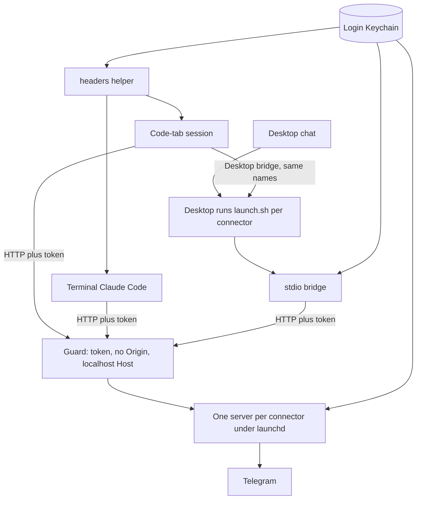
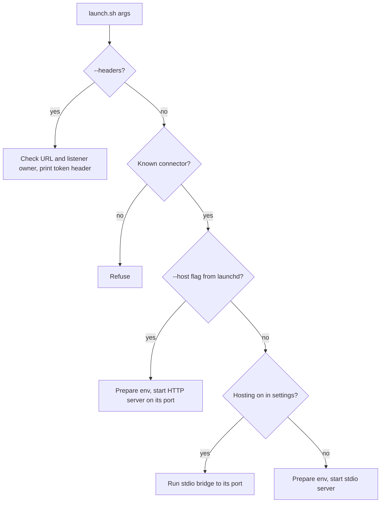
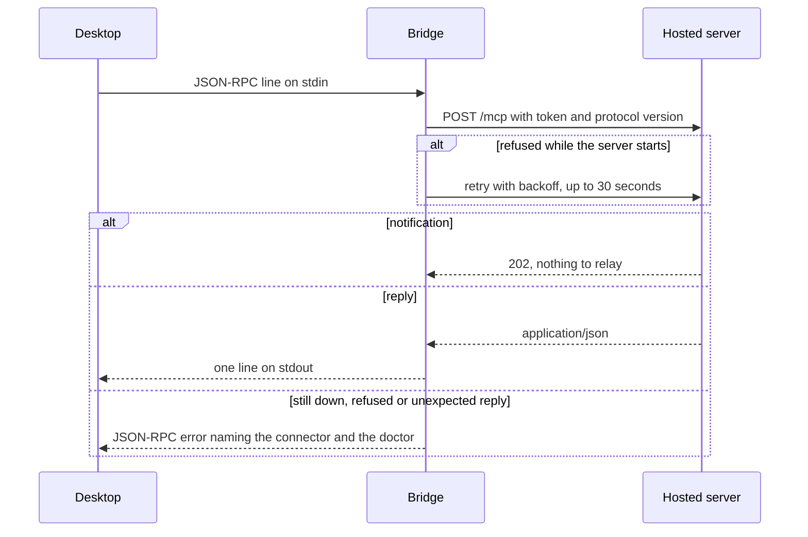

# Telegram connectors hosted once on localhost - Plan

## Goal Capsule

- **Goal:** every Telegram connector name means one tool set and one server process on the Mac, shared by Claude Desktop chat, Code-tab sessions and terminal Claude Code over 127.0.0.1, with all connector code living in this repo.
- **Done signal:** a fresh Code-tab session shows `tg_main` 14, `tg_saved` 1, `tg_bots` 6, `tg_send` 9 and `tg_fu` 4 tools with none removed across turns; Desktop chat shows `tg_main` 14, `tg_saved` 1 and `tg_bots` 6; two Claude Code sessions share one server process per connector; the doctor passes; the PR is open.
- **Scope edges:** connector code, hosting, a new `tg_send` connector, the doctor, the product kit, the maintainer's live cutover and the consumers that name these connectors. Not the second Telegram account, the bulk-read CLI, the digest job, or an upstream connector upgrade.
- **Biggest risks:** breaking connectors in daily use during cutover; a hosted endpoint reachable by something other than the user's Claude clients.

---

## Product Contract

### Summary

The maintainer's Mac runs a separate copy of each Telegram connector for every Claude client and session (18 copies at last count, about 105 MB each). Since Claude Desktop began bridging its own connectors into Code-tab sessions, a name defined in both Desktop and Claude Code with different tool sets flips between them: `tg_main` drops from 23 tools to 14 mid-session. This plan gives each connector one role, one tool set and one server process, hosted on localhost under launchd, and moves the code that defines them into this repo. Other people's installs keep working unchanged and gain a clash warning plus opt-in hosting.

### Problem Frame

Claude Code keeps one registration per server name, and the last registration to arrive defines the tool list. Desktop pushes its configured servers into every Code-tab session under plain names and re-sends them at turn start. The maintainer's Desktop config defines `tg_main` with the Desktop read-and-draft set (14 tools); the Claude Code user config defines `tg_main` with the Claude Code set that adds nine write tools (23). In a Code-tab session the Desktop copy lands first, the Claude Code copy adds the writes, and the next Desktop re-send removes them. `tg_bots` has the same split, but both copies expose identical tools, so it is invisible. Nothing checked for a name defined differently in both configs.

The setup that produced this is spread across a private folder with a launcher, a tool trimmer, a health check and allowlist files, while a near-copy of the same launcher ships in this repo's kit. Each fix lands twice or drifts.

### Requirements

| ID | Requirement |
|----|-------------|
| R1 | Every connector name resolves to exactly one tool set in every client, and no tool disappears between turns. |
| R2 | Each enabled connector runs as one server process on the Mac, shared by every client over 127.0.0.1. Desktop reaches it through a light bridge process. |
| R3 | A hosted endpoint answers only requests that carry that connector's token, arrive on the loopback interface, and carry no browser `Origin`. |
| R4 | Connector limits stay exactly as today (table below). No connector gains a tool, a chat, or a skipped prompt. |
| R5 | The doctor fails when a connector name is defined in both Desktop and Claude Code with a different instance or tool set, and passes on the finished setup. |
| R6 | All connector code lives in this repo and is deployed from it. Private values (Keychain service and item names, chat and bot IDs, personal paths) live only in local files outside the repo, and the build and pre-commit scans keep refusing them. |
| R7 | Existing installs of the kit keep working after an update with no action (stdio, Desktop only). They gain the clash warning, and can opt in to hosting and to Claude Code registration. |
| R8 | The maintainer's cutover is staged, backed up, reversible in one documented step, and sends no Telegram message. |
| R9 | Everything that names these connectors (skills, global instructions, permission rules, the memory plugin's skip list) names the right connector after cutover. |
| R10 | The private connector folder becomes the deployment target and private-values home. Its uncommitted changes are committed before anything moves, and its history is kept. |

Connector limits that R4 preserves:

| Connector | Login | Clients | Tools | Limit |
|-----------|-------|---------|-------|-------|
| `tg_main` | Desktop login | Desktop, Code tab, terminal | 14: reads, drafts, contact lookup | No sends |
| `tg_saved` | Desktop login | Desktop (and Code tab through Desktop's bridge) | 1: `send_message` | Only the user's own chat |
| `tg_bots` | Desktop login | Desktop, Code tab, terminal | 6: send, read, buttons, files | Only allowlisted bots; files only from its outbox |
| `tg_send` | Claude Code login | Code tab, terminal | 9: send, reply, edit, pin, unpin, schedule, list and delete scheduled, send file | Each write asks; numeric chat IDs only; files only from its files folder |
| `tg_fu` | Claude Code login | Code tab, terminal | 4: send, edit, list, link | Exactly one allowlisted chat; no prompt |
| `tg_reader` | Second account | none yet | reads plus public search | Planned, not registered |

### Key Decisions

- **Role-named connectors, one process each.** `tg_main`, `tg_saved` and `tg_bots` are shared by every client under the same names with identical tools; Claude Code's writes move to a new `tg_send`; `tg_fu` stays Claude Code only. Governs R1, R2, R4. (session-settled: user-directed — chosen over duplicate `_cc`-suffixed names and over leaving Desktop instances to serve both: one name must mean one tool set, and writes stay out of Desktop chat.)
- **The clash fix ships inside this revamp.** Governs R1, R5. (session-settled: user-directed — chosen over a standalone config fix today: the revamp removes the cause instead of patching one name.)
- **Terminal Claude Code uses the same names and the same process.** Governs R2. (session-settled: user-directed — chosen over a terminal-only wrapper or a separate terminal set: the terminal is used regularly and should behave like the Code tab.)
- **Desktop also uses the shared processes, through a small stdio bridge.** Governs R2. (session-settled: user-approved — chosen over Desktop keeping its own stdio copies: Desktop's config accepts only stdio commands, and a stdlib bridge costs about 16 MB against about 105 MB per connector copy.)
- **Shared processes reuse the existing Keychain logins.** Governs R4, R8. (session-settled: user-approved — chosen over a fresh login per connector: no QR re-scan and no new device entries.)
- **Other people's installs keep stdio by default.** Hosting and Claude Code registration are opt-in commands. Governs R7. (session-settled: user-approved — chosen over switching every install to hosting: a background service should be a choice.)
- **The private folder becomes the deployment target.** The allowlists, outbox, Cowork skill and private settings stay at their current paths; its git tracks only private files. Governs R6, R10. (session-settled: user-approved — chosen over retiring the folder: consumers already point at those paths.)

### Scope Boundaries

- No second Telegram account; `tg_reader` keeps launcher support and stays unregistered.
- The bulk-read CLI, its skills, the digest job and the Cowork skill change only where they name a connector.
- No upstream connector upgrade: the pinned commit already serves streamable HTTP.
- No new limits loosened or tightened; permission prompts for tools outside `tg_send` stay as they are.

#### Deferred to Follow-Up Work

- Offering `tg_send` and single-chat connectors to other users through the setup skill.
- Log rotation for the hosted connectors, if the warning-level logs ever grow.

---

## Planning Contract

### Context and Research

- `skills/telegram-setup/kit/launch.sh` is the product launcher: one Keychain service, one login, three connectors, stdio only. The maintainer's private launcher is a superset: two logins chosen by a surface argument (`desktop` or `cc`), `tg_send`-style writes inside `tg_main` for `cc`, `tg_fu`, `tg_reader`.
- `skills/telegram-setup/kit/serve.py` is identical to the maintainer's live copy. It prunes the connector's tools to `TG_TOOLS_ALLOW`, adds `schedule_topic_message` and `list_topic_messages`, then calls the connector's own entry point.
- The pinned connector (chigwell/telegram-mcp v3.2.66) serves streamable HTTP when `MCP_TRANSPORT=http`, through a module-level FastMCP instance created with `stateless_http=True` and the default path `/mcp`. FastMCP turns on DNS-rebinding protection for a 127.0.0.1 host, allowing only localhost `Host` values. It has no authentication of its own. It connects to Telegram before it opens its port.
- The connector's entry point parses `sys.argv` itself: every positional word becomes an extra allowed file root, and `--transport`, `--host` and `--port` are its own options. None of its tools streams progress or log messages, so plain JSON replies (FastMCP `json_response`) lose nothing.
- `skills/telegram-setup/kit/tgsetup.py` owns login, bots, Desktop registration and the product doctor; `ours(entry)` recognises our Desktop entries by launcher path. `skills/telegram-setup/kit/setup.sh` always installs into one fixed home folder and runs login, bots, registration and the doctor on every install. The maintainer's `tg-doctor` probes each connector over stdio, checks both configs, the permission rules, the memory plugin's skip list, and several private extras (bulk-read CLI, digest job, Cowork skill, legacy session files).
- Claude Code accepts HTTP servers with a `headersHelper` command in user scope; user-scope helpers run without workspace-trust gating and receive `CLAUDE_CODE_MCP_SERVER_NAME` and `CLAUDE_CODE_MCP_SERVER_URL`. Entries go in through `claude mcp add-json --scope user`. Running Claude Code sessions rewrite the Claude Code user config continually.
- Claude Desktop's config accepts stdio commands only, and Desktop bridges its configured servers into Code-tab sessions under their plain names.
- launchd agents in the user's GUI session read the login Keychain silently (verified on this Mac earlier).
- `scripts/build.sh` syntax-checks the kit, scans every tracked file for private values (generic patterns plus a private pattern file outside the repo), and builds `dist/telegram-setup.zip`; the pre-commit hook runs it with `--check`. The repo has no tests yet.

### Key Technical Decisions

- KTD1. **Launcher logic moves into Python; `launch.sh` becomes a one-line shim.** A shared module reads an optional `settings.json` beside the install (connectors, logins, ports, Keychain service), falling back to today's product defaults when absent, so existing installs see no change (R7). Bash cannot read JSON settings safely, and one Python implementation can be unit-tested. The env scrub, `.env` refusal, Keychain watchdog and allowlist refusals port across unchanged. Covers R4, R6, R7.
- KTD2. **HTTP rides the connector's own FastMCP app.** `serve.py` sets the connector's FastMCP instance to JSON replies, then replaces its `run_streamable_http_async` with one that wraps `streamable_http_app()` in our ASGI guard and runs uvicorn bound to 127.0.0.1. Before handing over, `serve.py` resets `sys.argv` so its own arguments never reach the connector's parser; transport, host and port travel only through the environment. The connector source stays untouched at its pin. Covers R2, R3, R4.
- KTD3. **One token per connector, kept in the Keychain under the install's service.** The guard compares the bearer token in constant time, refuses any request with an `Origin` header (Claude Code and the bridge send none; browsers always do on a cross-site POST), and leaves FastMCP's Host check on. Clients use the literal `http://127.0.0.1:<port>/mcp`, never `localhost`. The headers helper and the bridge release a token only for that connector's recorded URL, and only when the listener on its port belongs to the current user; otherwise they fail closed. The token keeps out other local users and web pages, not code already running as the user, which could read the login itself from the same Keychain. Covers R3.
- KTD4. **Claude Code connects straight over HTTP; Desktop goes through the bridge.** Claude Code entries are `type: http` with `headersHelper` set to `launch.sh --headers`. Desktop entries stay `launch.sh <connector>`; when hosting is on, the launcher runs the stdlib bridge instead of a server. Desktop's config shape and `ours()` keep working. Covers R1, R2, R7.
- KTD5. **One launchd agent per hosted connector.** RunAtLoad, KeepAlive, a throttle interval, logs in the state folder at warning level, labels from a settings prefix. One process cannot host several connectors: the connector reads its tool set, allowlists and login from the environment at import and keeps one module-level server and Telegram client. Five server processes replace eighteen full copies; Desktop's bridges are separate processes of about 16 MB each. Covers R2.
- KTD6. **Fixed ports from settings.** The product's `host on` takes the first free ports from 47601 upward and records them; the doctor checks that each port answers as the right connector. Covers R2, R5.
- KTD7. **Logins follow the clients.** Connectors that Desktop shares keep the Desktop login; Claude Code–only connectors keep the Claude Code login; device names stay as they are. Covers R4, R8.
- KTD8. **One doctor, in the kit.** `tgsetup.py doctor` gains the clash check, HTTP probes, agent and port checks, Claude Code registration checks, per-role tool counts, and a check that every write tool of a role that asks has an ask rule in Claude Code's user settings. The maintainer's `tg-doctor` becomes a thin wrapper that runs it, then an optional private extras script: the memory plugin's skip-list check (updated for `tg_send`) and the checks for out-of-scope features. Covers R4, R5, R6, R9.
- KTD9. **Stdlib `unittest` under `tests/`, no network and no Telegram.** `scripts/build.sh --check` runs it, so the pre-commit hook does too. Covers R1, R3, R5.
- KTD10. **The launcher accepts the legacy surface argument during cutover.** `launch.sh <name> desktop|cc` starts the named connector and notes the ignored argument on stderr, so a session that respawns a connector mid-cutover still gets a working process. The doctor still reports any registration that carries the argument. Covers R8.
- KTD11. **Rollback is restore-and-stop, in one ordered checklist.** Every config edit takes a timestamped backup first. Claude Code entries roll back entry by entry (`claude mcp remove`, then `claude mcp add-json --scope user` from the backup), because running sessions rewrite that file; the Desktop config and Claude Code user settings roll back by whole-file restore. Then `host off`, and the old launcher and trimmer come back from the private folder's commit made before cutover. Covers R8, R10.

### High-Level Technical Design

Directional sketches, not implementation specifications.

Component layout after cutover:

What `launch.sh <args>` does:

One request through the bridge:

Settings decide the mode per install:

| Install | Settings file | Desktop entry runs | Claude Code entry | Server processes per connector |
|---------|---------------|--------------------|-------------------|--------------------------------|
| Existing product install | absent | stdio server | none | one per client |
| Product, `register --code` | present, stdio | stdio server | stdio, same launcher and connector | one per client, identical tools |
| Product, `host on` | present, http | bridge | HTTP | one |
| Maintainer install | present, http | bridge | HTTP | one |

### Risks

| Risk | Mitigation |
|------|------------|
| Cutover breaks connectors in daily use | Deploy only after backups and a rollback rehearsal; check stdio starts before hosting; legacy-argument support; one ordered rollback |
| A hosted process dies or is still connecting, and clients lose Telegram | KeepAlive restarts it; the bridge retries for up to 30 seconds, then answers with an error naming the doctor; the doctor checks every port |
| A web page reaches a port | Loopback bind, token, Origin refusal, Host check; a test for each refusal |
| Another local user binds a stopped connector's port to collect its token | Clients use the literal loopback address and release the token only to a listener owned by the current user |
| A write runs without its prompt during cutover | `tg_send` ask rules land before `tg_send` is registered; `tg_main` write rules go only after no pre-cutover process remains |
| Many sessions share one Telegram client | The connector is async and already shares one login across clients today; flood waits surface as tool errors as before |
| A future connector pin moves the FastMCP internals `serve.py` relies on | `serve.py` refuses to start with a clear error when the hook point is missing; the doctor reports it; the pin does not move in this plan |
| A private value slips into the repo through new docs or tests | The build scan covers every tracked file; new private values found during the work go into the private pattern file |

### Open Questions

#### Deferred to Implementation

- Whether Desktop's bridge into Code-tab sessions talks to the hosted process through Desktop's own bridge process or starts its own per session; either way the tools are identical, so it affects only the bridge count the verification observes.
- Exact uvicorn options for quiet logging and graceful shutdown under launchd.

---

## Implementation Units

### U1. Shared connector settings and role table

- **Goal:** one module that every entry point reads for connectors, roles, logins, ports and Keychain access.
- **Requirements:** R4, R6, R7; KTD1, KTD7.
- **Dependencies:** none.
- **Files:** `skills/telegram-setup/kit/connectors.py` (new), `tests/test_connectors.py` (new).
- **Approach:** a role table (`read`, `saved`, `bots`, `send`, `chat`, `reader`) gives each role its exposed-tools mode, tool allowlist, allowlist source and which of its tools are writes that ask. Settings map connector names to a role, a login item, clients, a port and a files folder. With no settings file, the module returns today's product defaults exactly. Keychain reads go through `/usr/bin/security` with a timeout and never print values.
- **Patterns:** the `READS` list and per-connector `TOOLS`/`ALLOW` pairs in `skills/telegram-setup/kit/launch.sh`; Keychain helpers in `skills/telegram-setup/kit/tgsetup.py`.
- **Test scenarios:**
  - No settings file: connectors are `tg_main`, `tg_saved`, `tg_bots` with 14, 1 and 6 tools, the product Keychain service, Desktop clients only, hosting off.
  - A settings file with all six roles: `send` gives exactly the nine write tools; `chat` gives exactly four; `read` gives no send tool.
  - A connector naming an unknown role, a duplicate port, or a port outside 1024–65535 is refused with a message naming the connector.
  - A settings file that is not valid JSON is refused rather than falling back to defaults.
- **Verification:** `python3 -m unittest discover tests` passes.

### U3. Stdio-to-HTTP bridge

- **Goal:** Desktop reaches the hosted connector through a stdlib-only process.
- **Requirements:** R2, R3; KTD3, KTD4.
- **Dependencies:** U1.
- **Files:** `skills/telegram-setup/kit/bridge.py` (new), `tests/test_bridge.py` (new).
- **Approach:** read JSON-RPC lines from stdin, POST each to the connector's recorded `127.0.0.1` URL with the token, and relay each JSON reply as one stdout line under a lock, one thread per request so slow tools do not block others. A 202 relays nothing. Remember the negotiated protocol version and send it on later requests. Before sending the token, confirm the listener on the port belongs to the current user. On a refused connection, retry with backoff for up to 30 seconds, since the server opens its port only after it reaches Telegram. Then, or on a 401, a foreign listener or a reply that is not JSON, answer each request that has an id with a JSON-RPC error naming the connector and the doctor. Exit on stdin EOF.
- **Patterns:** none in the repo; the request sequence above.
- **Test scenarios:**
  - Against a local test server: a JSON reply is relayed as one line; a 202 for a notification relays nothing.
  - Two requests in flight where the first is slow: the second's reply is written first, and no line is interleaved.
  - The test server starts listening 3 seconds after the first request: the `initialize` reply still reaches stdout.
  - Server never comes up: after the retry window, a request with an id gets a JSON-RPC error naming the connector; a notification gets nothing.
  - A 401 from the server becomes an error that says the token does not match and names the doctor.
  - A listener not owned by the current user: no request is sent and the token never leaves the process.
- **Verification:** unit tests pass; the bridge's resident memory stays near 16 MB while relaying.

### U2. Launcher and server: role-based start, stdio and HTTP with the guard

- **Goal:** one entry point starts any connector from settings over stdio or HTTP, runs the bridge or prints the token header, and guards the HTTP side.
- **Requirements:** R2, R3, R4; KTD1, KTD2, KTD3, KTD10.
- **Dependencies:** U1, U3.
- **Files:** `skills/telegram-setup/kit/serve.py`, `skills/telegram-setup/kit/launch.sh`, `skills/telegram-setup/kit/guard.py` (new), `tests/test_guard.py` (new), `tests/test_launch_args.py` (new).
- **Approach:** `launch.sh` execs the connector's Python on `serve.py` with its arguments, and `serve.py` owns the whole decision tree in the sketch above: `--headers` prints the bearer header after the URL and listener-owner checks of KTD3; a known connector with hosting on and no `--host` runs the bridge; otherwise it starts a server. Port the launcher's environment preparation (scrub inherited Telegram and MCP variables, refuse a `.env` in the working tree, read the Keychain, set allowlists, files root, exposed tools, device name) into `serve.py`. Keep the pruning and extra tools. Reset `sys.argv` before calling the connector's entry point and set its FastMCP instance to JSON replies before building the HTTP app. The guard is a plain ASGI wrapper so it is testable without uvicorn: 403 for any request with an `Origin` header, 401 without the right bearer token, lifespan events passed through untouched. Top-level imports stay stdlib-only so the bridge and headers paths stay light.
- **Patterns:** current `skills/telegram-setup/kit/launch.sh` refusals; `prune` and `register_extras` in `skills/telegram-setup/kit/serve.py`.
- **Test scenarios:**
  - Guard: no token gives 401; a wrong token of the same length gives 401; the right token with an `Origin` header gives 403; the right token without `Origin` reaches the app; a lifespan event reaches the app.
  - Arguments: `tg_main` and the legacy `tg_main cc` select the same connector; an unknown connector exits non-zero.
  - Starting with `tg_main cc` or `tg_main --host` leaves the connector's allowed file roots equal to the configured files folder alone.
  - `--headers` with an unknown or malformed `CLAUDE_CODE_MCP_SERVER_NAME`, a `CLAUDE_CODE_MCP_SERVER_URL` that is not the connector's recorded URL, or a port with no listener owned by the user exits non-zero and prints nothing.
  - An empty allowlist file for a `bots` or `chat` connector refuses to start; a `chat` allowlist with two chats refuses to start.
  - Inherited `TELEGRAM_*` and `MCP_*` variables do not reach the connector's environment.
- **Verification:** unit tests pass; a hosted `tg_main` on a spare port answers `initialize` and lists 14 tools with the token, and refuses without it.

### U4. Hosting control

- **Goal:** one command turns hosting on or off for an install, and Claude Code entries follow it.
- **Requirements:** R2, R3, R7, R8; KTD3, KTD5, KTD6, KTD11.
- **Dependencies:** U1, U2.
- **Files:** `skills/telegram-setup/kit/tgsetup.py`, `tests/test_hosting.py` (new).
- **Approach:** `host on` writes or updates settings, picks free ports, creates a random token per connector in the Keychain, writes one launchd plist per hosted connector into the user's LaunchAgents, bootstraps each, and waits for each port to answer `initialize`. `host off` boots the agents out, removes the plists, flips settings back to stdio and keeps the tokens unless asked. Both finish by re-registering any of our connectors already in Claude Code (HTTP while hosted, the stdio launcher otherwise). `host status` lists agents, ports and answers. `unregister` with the uninstall flow runs `host off` and deletes the tokens along with the login items. The headers helper itself lives in U2.
- **Patterns:** `load_config`/`save_config` backup-and-replace in `skills/telegram-setup/kit/tgsetup.py`.
- **Test scenarios:**
  - The generated plist runs the launcher with the connector and `--host`, sets RunAtLoad and KeepAlive, logs into the state folder, and contains no token.
  - Port picking skips a port that is already bound.
  - `host off` after `host on` leaves settings in stdio mode, lists no agent files, and leaves no HTTP Claude Code entry for our connectors.
  - Uninstall after `host on` leaves no agent files and no hosting tokens.
- **Verification:** unit tests pass; `host on` and `host status` against a throwaway settings file on spare ports show each connector answering, and `host off` removes them.

### U5. Registration and doctor with the clash check

- **Goal:** register connectors in the right clients and catch a split definition before a user sees it.
- **Requirements:** R1, R4, R5, R7; KTD4, KTD8, KTD10.
- **Dependencies:** U1, U4.
- **Files:** `skills/telegram-setup/kit/tgsetup.py`, `tests/test_doctor.py` (new).
- **Approach:** `register` writes Desktop entries for connectors whose clients include Desktop, and, with `--code` or when settings list Code clients, Claude Code user entries through `claude mcp add-json --scope user` (HTTP when hosted, otherwise the same stdio launcher and connector as Desktop). `unregister` removes both. The doctor probes each connector over the route its clients use, compares tool counts with the role table, checks agents and ports when hosted, and checks that every asking write tool of a registered role has an ask rule. The clash check compares our entries as written: a Desktop and a Claude Code entry for one name agree only when both run our launcher with exactly that connector name, or the Claude Code entry is HTTP on that connector's recorded port. An entry that still carries a `desktop` or `cc` argument is reported as a stale split registration, even though the launcher now starts the same connector.
- **Execution note:** write the clash test first against fixtures shaped like today's configs, and see it fail before the check exists.
- **Patterns:** `cmd_register`, `ours` and `cmd_doctor` in `skills/telegram-setup/kit/tgsetup.py`.
- **Test scenarios:**
  - Fixture with Desktop `launch.sh tg_main desktop` and Claude Code `launch.sh tg_main cc`: the clash check fails and names `tg_main`.
  - Desktop `launch.sh tg_main` with Claude Code HTTP on `tg_main`'s port: passes.
  - Claude Code HTTP entry for `tg_main` pointing at `tg_bots`'s port: fails.
  - A non-Telegram name in both configs with different commands is not reported.
  - Only a Desktop entry, no Claude Code entry: passes (existing product installs).
  - A registered `send` role with one write tool missing its ask rule: fails and names the tool.
- **Verification:** unit tests pass; the doctor reports the clash on a copy of today's configs and passes on a hosted-shaped fixture.

### U6. Product surface and release

- **Goal:** other users get the same code, the clash warning and opt-in hosting through the setup skill; the maintainer can deploy the kit into any folder.
- **Requirements:** R6, R7; KTD8, KTD9.
- **Dependencies:** U1–U5.
- **Files:** `skills/telegram-setup/kit/setup.sh`, `skills/telegram-setup/kit/README.md`, `skills/telegram-setup/SKILL.md`, `skills/telegram-setup/references/troubleshooting.md`, `.claude-plugin/plugin.json`, `.claude-plugin/marketplace.json`, `scripts/build.sh`, `README.md`.
- **Approach:** `setup.sh` copies the new files and gains `host`, `register --code` and `deploy <folder>`, which copies the kit and syncs the pinned connector into that folder and skips login, bots, registration and the doctor. `uninstall` runs `host off` and removes the hosting tokens before deleting folders. The skill's later-requests section offers hosting and Claude Code registration; troubleshooting explains a tool list that changes between turns and points at the doctor. `scripts/build.sh` syntax-checks the new Python files and runs the tests in `--check`. Version 0.2.0.
- **Test expectation:** covered by U1–U5 tests and the build's checks; this unit is wiring and docs.
- **Verification:** `scripts/build.sh` passes and rebuilds `dist/telegram-setup.zip`; `setup.sh deploy` into a scratch folder produces a kit whose `tg_main` starts over stdio with 14 tools when no settings file is present.

### U7. Maintainer private folder prepared

- **Goal:** the private folder holds its history, the private settings and the cutover checklist, ready for deployment.
- **Requirements:** R6, R8, R10; KTD8, KTD11.
- **Dependencies:** U1–U6.
- **Files:** outside the repo: the private folder's settings, git ignore list, README map, cutover checklist, `tg-doctor` wrapper and private extras script; the private pattern file.
- **Approach:** commit the private folder's uncommitted changes as they are, before anything else. Write a private settings file reproducing today's connector-to-login mapping, allowlist files and file roots. Ignore the files a deploy will write, so the private git tracks only private ones. Shrink the README map to a pointer at this repo plus the private file list. Write the private cutover checklist naming exact paths and consumers, with one ordered rollback section per KTD11. Write the private extras script with the memory skip-list check updated for `tg_send`. Add the new Keychain item names to the private pattern file.
- **Test expectation:** none -- local preparation; verified by the doctor in U8.
- **Verification:** the private folder's git shows a commit for the earlier changes; the build scan passes; the live launcher is still the old one.

### U8. Live cutover

- **Goal:** the maintainer's clients use the hosted connectors.
- **Requirements:** R1, R2, R4, R8, R9; KTD10, KTD11.
- **Dependencies:** U7, and the user's OK on this plan.
- **Files:** outside the repo: the private folder, Claude Desktop config, Claude Code user config, Claude Code user settings, the memory plugin's settings.
- **Approach:** in order: back up every config; rehearse the rollback on copies (entry-level for the Claude Code user config); deploy the kit into the private folder with `setup.sh deploy`; confirm each connector starts over stdio with the right tool count; turn hosting on and confirm every port answers with the right tool count. Then add the ask rules for `tg_send`'s nine write tools; swap the Claude Code entries through `claude mcp remove` and `claude mcp add-json --scope user`; re-register Desktop entries without the surface argument; add `tg_send`'s tools to the memory plugin's skip list; leave the deny list and every other rule alone. Run the doctor, then ask the user to quit and reopen Claude Desktop. After the restart, once the doctor finds no connector process left from before cutover, remove the `tg_main` write-tool ask rules as the last step.
- **Execution note:** no Telegram send at any step; the doctor's allowlist probes are refused locally before any network call.
- **Test expectation:** none -- live configuration; the Verification Contract covers it.
- **Verification:** the doctor with extras passes; a timestamped backup exists for every edited config; the rollback rehearsal restored the copies.

### U9. Consumers

- **Goal:** everything that names these connectors names the right one.
- **Requirements:** R9.
- **Dependencies:** U8.
- **Files:** outside the repo: the Telegram section of the global instructions, the personal skills that use Telegram writes, the bulk-read skill's notes on connectors, the Cowork search skill.
- **Approach:** replace write-tool references on `tg_main` with `tg_send`; describe `tg_main` as reads and drafts everywhere; leave read-only references alone. Back up each file before editing.
- **Test expectation:** none -- documentation.
- **Verification:** a search of those files finds no `tg_main` write tool.

---

## Verification Contract

| Check | How | Units |
|-------|-----|-------|
| Unit tests | `python3 -m unittest discover tests` | U1–U5 |
| Build, syntax and privacy scan | `scripts/build.sh` and `scripts/build.sh --check` | U6, U7 |
| Endpoint refusals | `curl` to each port: no token gives 401, an `Origin` header gives 403, the token gives a JSON-RPC reply | U2, U4, U8 |
| Tool counts per connector | doctor: 14, 1, 6, 9, 4 | U5, U8 |
| Prompts and memory | doctor with extras: every `tg_send` write tool has an ask rule and every `tg_send` tool is on the memory skip list | U5, U7, U8 |
| One server process per connector | while two Claude Code sessions are connected, a process count shows one server per connector | U8 |
| Code tab keeps its tools | after the Desktop restart, a fresh Code-tab session's tool deltas show no removal for any `tg_` name across turns | U8 |
| Desktop chat | Desktop lists `tg_main` 14, `tg_saved` 1, `tg_bots` 6 | U8 |
| No send | no write tool called during the work; server logs show no send | U8 |
| Rollback works | the ordered rollback rehearsed on copies before the live swap, entry-level for the Claude Code user config | U7, U8 |

---

## Definition of Done

- A fresh Code-tab session shows `tg_main` 14, `tg_saved` 1, `tg_bots` 6, `tg_send` 9 and `tg_fu` 4 tools with none removed across turns, and Desktop chat shows `tg_main` 14, `tg_saved` 1 and `tg_bots` 6.
- Two Claude Code sessions share one server process per connector over 127.0.0.1.
- The doctor passes on the maintainer's Mac and fails on a fixture of today's split configs.
- All connector code lives in this repo; the private folder holds only private values and a deployed copy; the build scan passes.
- Existing product installs start unchanged with no settings file.
- Consumers, permission rules and the memory skip list name `tg_send` for writes.
- The work is on a branch with a PR open on this repo; changes outside the repo are listed in the PR description without private values.
